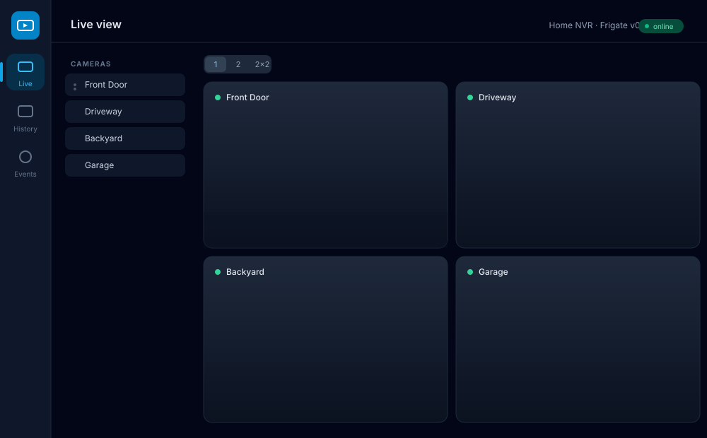
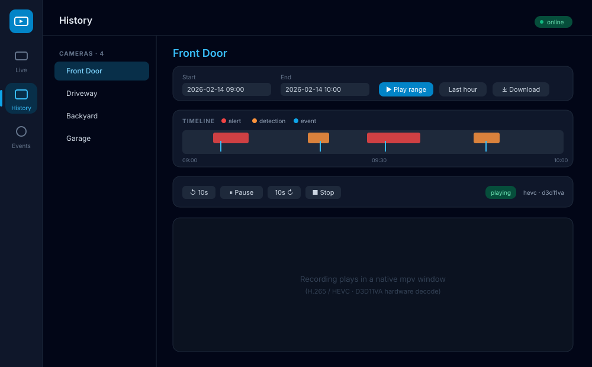
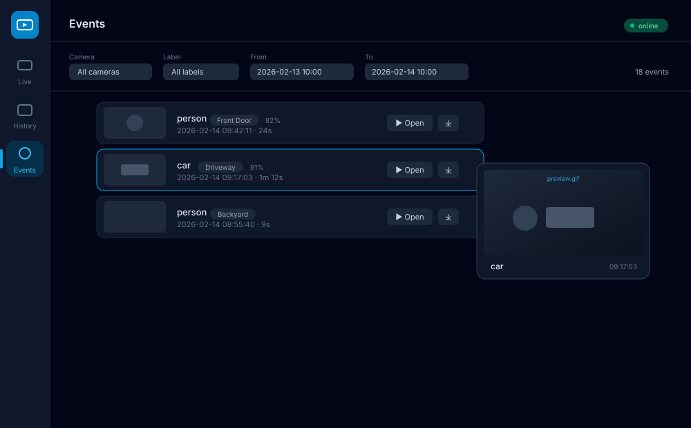

<div align="center">

# FrigateDesk

**A native Windows desktop client for [Frigate NVR](https://frigate.video/)** — live view, recordings
history, review & events, built to go beyond the existing *live-only* clients.

[](LICENSE)

[](https://github.com/zenmorro/FrigateDesk/releases/latest)


<sub>Developed with the assistance of AI (Anthropic's Claude) · see [Acknowledgements](#acknowledgements)</sub>

</div>

> **Screenshots below are UI mockups** (illustrative camera names, no real footage).



<table>
<tr>
<td></td>
<td></td>
</tr>
</table>

---

## Why FrigateDesk?

Browser-based and live-only clients struggle with two things that matter for real NVR use:

1. **H.265 / HEVC recordings** — common on EZVIZ and many other cameras. In the browser/WebView stack
   HEVC often fails silently (infinite spinner): WebRTC does not carry HEVC at all, and MSE only decodes
   it when the OS has hardware + the HEVC extension installed.
2. **History, review and events** — not just the live grid.

FrigateDesk uses a **native video engine (mpv)** for recordings, giving **H.265 decoding with D3D11VA
hardware acceleration** (software fallback) and **explicit codec-error reporting** instead of a hung UI.
Live view streams go2rtc **MSE** inside the app window through a local authenticated proxy.

## Features

| Feature | Status |
|---|---|
| Multiple saved server profiles | ✅ |
| Login (Frigate 0.14+ auth on :8971, JWT) + self-signed TLS | ✅ |
| Credentials in Windows Credential Manager (DPAPI-encrypted) | ✅ |
| Automatic camera discovery (`/api/config`) | ✅ |
| **Live** multi-camera grid 1 / 2 / 2×2 with drag & drop (go2rtc MSE) | ✅ |
| **History** recording playback — HEVC/H.265, D3D11VA hardware decode | ✅ |
| Playback speed, seek, pause | ✅ |
| **Timeline** with detections (alerts/detections + events), click to seek | ✅ |
| Hover **preview** (animated `preview.gif`) on events & timeline | ✅ |
| **Download** a recording clip for any time range (X→Y) | ✅ |
| **Events** list with filters (camera / label / date) + thumbnails + open/download | ✅ |
| Light / dark theme | ✅ |
| Windows notifications (MQTT / polling) | ⏳ planned |
| Tray icon, start with Windows | ⏳ planned |
| winget publishing | ⏳ planned |

## Download & install

Grab the latest installer from the **[Releases page](https://github.com/zenmorro/FrigateDesk/releases/latest)**:

- **`FrigateDesk_x.y.z_x64_en-US.msi`** — MSI installer, or
- **`FrigateDesk_x.y.z_x64-setup.exe`** — NSIS setup.

Then: **install → open FrigateDesk → add your server + login → done.** No extra downloads —
**mpv is bundled**, the WebView2 runtime is already on Windows 10/11 (fetched automatically if missing),
and no Visual C++ redistributable is required.

## Frigate compatibility

| Frigate version | Notes |
|---|---|
| 0.14 – 0.16+ | Target range. Auth on port **8971**, `/api/login`, JWT cookie/bearer. |
| < 0.14 | Partial: use a profile with **auth disabled** (unauthenticated `:5000`). |

Live streaming relies on **go2rtc** (bundled with Frigate). Recommended camera codecs: H.264/AAC for
live; HEVC recordings are handled by the native mpv player.

## Privacy & security

- **Passwords** are stored in the **Windows Credential Manager** (encrypted at rest via Windows DPAPI,
  tied to your user account) — never in plaintext, never in the project files.
- **Server profiles** (URL, username, flags) live in `%APPDATA%\com.frigatedesk.app\profiles.json` —
  no secrets there.
- The **JWT** obtained at login is kept in memory only; it is never written to disk.
- All network access happens in the Rust backend; secrets, cookies and TLS never reach the WebView.
- No telemetry.

---

## Build from source

### Prerequisites

- **Node.js** 20+ and npm
- **Rust** (stable) via [rustup](https://rustup.rs/) + the **MSVC** toolchain (Visual Studio Build
  Tools, "Desktop development with C++")
- **7-Zip** (`winget install 7zip.7zip`) — only to unpack the bundled mpv at build time
- **WebView2 runtime** (preinstalled on Windows 10/11)

> **mpv is bundled automatically.** `scripts/fetch-mpv.ps1` downloads a self-contained `mpv.exe` into
> `src-tauri/resources/mpv/` (gitignored) and Tauri packs it into the installer. It runs automatically
> before `tauri dev` / `tauri build`. During development you can point `FRIGATEDESK_MPV` at an existing
> `mpv.exe` to skip the download.

### Commands

```powershell
npm install

# Development (hot-reload UI + Rust backend)
npm run tauri dev        # or: dev.cmd   (sets up PATH automatically)

# Production build → installers under src-tauri/target/release/bundle/
npm run tauri build      # or: build.cmd
```

`dev.cmd` / `build.cmd` are convenience launchers that prepend `%USERPROFILE%\.cargo\bin` to `PATH`,
so they work even from a terminal opened before Rust was installed.

### Tests

```powershell
npm test                 # TypeScript API-client contract tests (vitest)
cd src-tauri && cargo test   # Rust Frigate API client tests (wiremock mock server)
```

## Tech stack

| Area | Choice | Rationale |
|---|---|---|
| Shell | **Tauri 2** (Rust + WebView2) | Small installer, Rust backend for TLS/credentials/proxy |
| UI | **React + TypeScript + Tailwind v4** | Fast, typed, themeable |
| Recordings | **mpv** via JSON-IPC | Native HEVC + D3D11VA hardware decode, clean error reporting |
| Live | **go2rtc MSE** in a `<video>` via a local auth proxy | In-window, H.264 sub-streams |
| Secrets | **Windows Credential Manager** (`keyring`) | DPAPI-encrypted passwords |
| HTTP | **reqwest** (rustls) + **axum** proxy | Self-signed TLS, JWT injection, image/stream proxying |

## Architecture

```
React/TS UI (WebView2)  ──Tauri IPC──►  Rust backend (src-tauri/src)
  components/ live, history,              frigate/   HTTP client (reqwest, TLS, JWT), models
  events, timeline                        proxy.rs   local auth reverse-proxy (HTTP + WS)
  player/mse.ts (go2rtc MSE)              video.rs   mpv process + JSON-IPC
  api/ typed client                       secrets.rs Windows Credential Manager
  lib/store.ts (zustand)                  profiles.rs server profiles (no secrets)
                                          commands.rs Tauri command surface
```

- The live player and image previews reach Frigate through `proxy.rs` on `127.0.0.1`, which injects the
  JWT and terminates self-signed TLS — so the WebView talks same-origin with no cookie/CORS/cert issues.
- Frigate response types are modeled on both sides (`src/api/types.ts`, `src-tauri/src/frigate/models.rs`)
  and stay forward-compatible across versions via `extra` catch-all maps.

## Releases (maintainers)

Pushing a version tag builds and publishes the Windows installers as release assets
(see [`.github/workflows/release.yml`](.github/workflows/release.yml)):

```powershell
git tag v0.1.0
git push origin v0.1.0
```

The workflow uses [`tauri-action`](https://github.com/tauri-apps/tauri-action) and creates a **draft**
release with the MSI + NSIS attached; review and publish it from the Releases tab.

## Roadmap

- ✅ Connection & login · Live grid · History + timeline · Events · Download clips
- ⏳ Windows notifications (MQTT `frigate/events` or polling, with thumbnails)
- ⏳ Tray icon + start with Windows
- ⏳ Sub/main stream selection, two-way audio (WebRTC)
- ⏳ winget package

## Acknowledgements

FrigateDesk was developed **with the assistance of AI** (Anthropic's Claude, via Claude Code).
AI was used to help design the architecture, write and review code, and produce documentation.
All AI-assisted output was reviewed and tested before inclusion. Contributions — human or
AI-assisted — are welcome.

Built on top of the excellent [Frigate NVR](https://frigate.video/),
[go2rtc](https://github.com/AlexxIT/go2rtc), [mpv](https://mpv.io/) and
[Tauri](https://tauri.app/) projects.

## License

[GNU General Public License v3.0](LICENSE).
